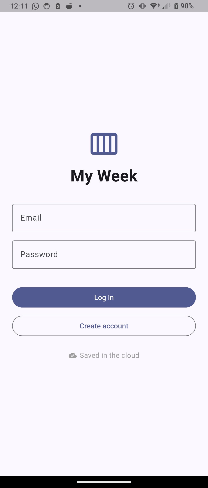
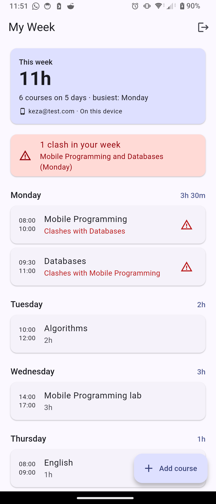

# My Week

My Week plans your week of courses: add, edit and delete courses, and see your hours per day, hours per week and any clashes, worked out live from your data. It signs users in with Firebase Authentication, and each user's data is saved in Cloud Firestore under their own id, so two accounts never see each other's data, and every change appears live.

## Screenshots

  
  <!--  -->
  <!--  -->
  

